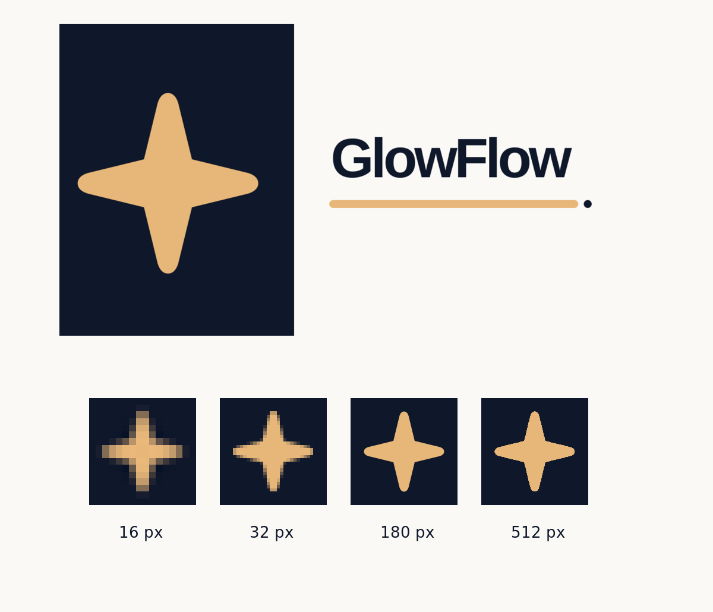

# GLOW-45 brand icons

The vector sources are `public/favicon.svg` and `public/og-glowflow.svg`. Their sparkle geometry is original and follows the dark-slate and rose-gold mark already used in the GlowFlow interface. The PNG and ICO files are rendered derivatives, not third-party artwork.

`favicon.ico` contains 16, 32, and 48 pixel images. The other browser and app assets are 32, 180, 192, and 512 pixels. `app/manifest.ts` advertises the app icons and starts in French, the current default language. Locale layout metadata advertises the browser, Apple, and social assets. Production metadata uses the custom domain; preview metadata uses its Vercel URL.

The draft pull request requires visual approval. After merge, confirm that the production tab shows the new icon and that `/favicon.ico`, `/favicon.svg`, `/apple-touch-icon.png`, `/icon-192.png`, `/icon-512.png`, `/og-glowflow.png`, and `/manifest.webmanifest` return successfully. Also inspect the production page's icon and social metadata. Do not mark GLOW-45 Done before that verification.

Country and city landing pages currently replace the locale layout's Open Graph metadata, so they do not inherit `og:image`. This PR intentionally avoids their GLOW-46 workstream. Add the GlowFlow social image to those page-level Open Graph objects in a coordinated follow-up after the brand asset is approved and merged. Until then, this story remains In Progress.
